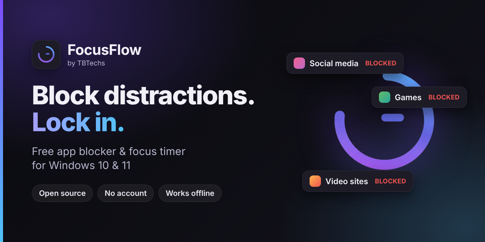
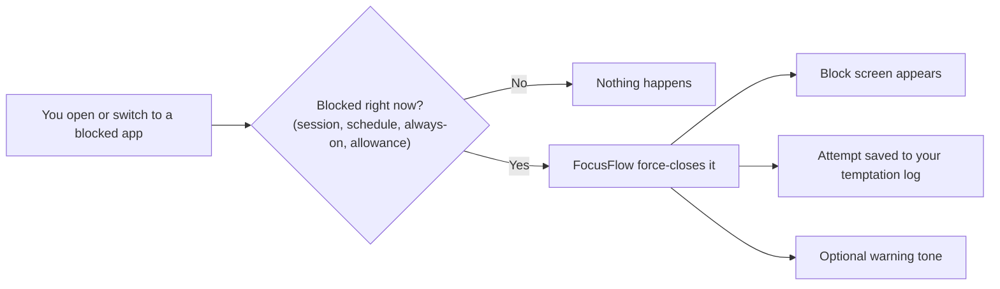

<p align="center">
  
</p>

<div align="center">

# FocusFlow — Free App Blocker & Focus Timer for Windows

**Block distracting apps and websites on Windows 10 & 11 — with a lock you can't just dismiss.**<br>
Free · Open source · No account · Works offline

<a href="https://apps.microsoft.com/detail/9njn9fprq7t1?cid=github-readme"></a>

[Website](https://focusflowpc.pages.dev/) · [EXE / MSI installer](https://github.com/TITANICBHAI/FocusFlow-PC/releases/latest) · [FAQ](#faq) · [Report a bug](https://github.com/TITANICBHAI/FocusFlow-PC/issues/new/choose)

[](LICENSE)


[](https://github.com/TITANICBHAI/FocusFlow-PC/commits/main)


</div>

---

## What is FocusFlow?

**FocusFlow is a free, open-source app blocker, website blocker and focus timer for Windows 10 and 11.** You pick the apps and sites that eat your time. FocusFlow closes them as soon as they open, shows a block screen, and logs every attempt so you can see what pulls you away.

When you need to go all in, **Focus Launcher** turns your whole desktop into a distraction-free workspace that only the apps you allowed can enter — and a PIN you can't talk yourself out of keeps it that way.

Everything runs on your PC. There is no account, no cloud and no subscription.

| | |
|---|---|
| **What it is** | App blocker · website blocker · Pomodoro / focus timer · task, habit and focus tracker |
| **Platform** | Windows 10 and Windows 11 (64-bit) |
| **Price** | Free — no subscription, no in-app purchases |
| **License** | Open source, [GPL-2.0](LICENSE) |
| **Account & internet** | No account needed · works fully offline |
| **Your data** | Stays on your PC (`%USERPROFILE%\.focusflow\`) |
| **Languages** | English, Español, Português (Brasil), 简体中文, 日本語, 한국어, Deutsch, Français |
| **Microsoft Store name** | FocusFlow — Deep Focus & App Blocker |
| **Made by** | [TBTechs](https://tbtechs.pages.dev), an independent software studio |

## Install

| | How | Best for |
|---|---|---|
| **Microsoft Store** (recommended) | [Get FocusFlow from the Store](https://apps.microsoft.com/detail/9njn9fprq7t1?cid=github-readme) | Most people — updates automatically |
| **winget** | `winget install --id 9NJN9FPRQ7T1 --source msstore` | Command-line installs and setup scripts |
| **EXE / MSI installer** | [Latest release](https://github.com/TITANICBHAI/FocusFlow-PC/releases/latest) | Adds uninstall protection for Nuclear Mode and Standalone Blocks. No built-in updater — download new versions from Releases |

Windows controls how Microsoft Store apps are removed, so uninstall protection works only with the EXE / MSI installer.

## Start in 60 seconds

1. **Install and open FocusFlow.** Accept the permission prompts on first launch — they are how FocusFlow closes blocked apps.
2. **Open *Block Apps*** and add the apps that eat your time, or start from a preset: *Social Media, Web Browsers, Gaming, Entertainment, Messaging & Chat, Work Mode* or *Deep Focus*.
3. **Open *Focus***, choose a length (15, 25, 45, 60 or 90 minutes, or your own) and press Start. Blocked apps now close the moment they appear.
4. **Want it stricter?** Turn on *Always-On Enforcement* in *Block Defense*, add a schedule, or start a **Focus Launcher** session to lock the whole desktop.

## Why FocusFlow

Most focus tools *ask* you to behave. A reminder is easy to dismiss, and a browser extension only covers one browser. FocusFlow works at the Windows level instead.

| | Reminders, timers & browser extensions | **FocusFlow** |
|---|---|---|
| **Blocked apps** | Keep running | Closed as soon as they open |
| **Websites** | Only in the browser where the extension is installed | Blocked for the whole PC, in every browser |
| **Dismissing the block** | Usually one click | PIN-protected, with Block Defense and Nuclear Mode on top |
| **Locking the desktop** | Not possible | Focus Launcher (kiosk mode) on every monitor |

## Features

### Block apps, websites and keywords

- **App blocker.** Add any Windows program by name or pick from your installed apps. When a blocked app comes to the front, FocusFlow force-closes it and shows a block screen. Microsoft Store (UWP) apps are covered too.
- **One-tap presets.** *Social Media, Web Browsers, Gaming, Entertainment, Messaging & Chat, Work Mode, Deep Focus.*
- **Website blocker.** Blocks domains for the whole PC through the Windows hosts file (IPv4 and IPv6), so it works in every browser with no extension. Needs administrator permission.
- **Keyword blocker.** Watches the foreground window title for words you choose, with quick presets. A match can close the whole browser — to keep your tabs open, use *Network Cutoff Rules* instead.
- **VPN & Network Shield.** Closes popular VPN clients that could be used to dodge a block, and adds firewall rules that cut an app's internet connection while leaving the app open.
- **Block when you want.** During focus sessions (the default), always on, on a weekly schedule, or as a one-off *Standalone Block*.
- **Daily allowances.** Give an app a daily time budget — say 30 minutes of video — and block it for the rest of the day. Allowances reset at midnight.
- **Edge extension (optional).** The [FocusFlow Edge extension](https://microsoftedge.microsoft.com/addons/detail/mmjhejklaaljidnmabjiloceniacihkk) adds browser URL and page-description matching in Microsoft Edge.

### Lock in for deep work

- **Focus Launcher (kiosk mode).** A full-screen workspace on every monitor. It hides the taskbar, covers the desktop and lets through only the apps you allowed. Breaks are 3, 5, 10 or 15 minutes — none, a fixed number, or unlimited — and need a one-time PIN. *Hard Lock* removes breaks entirely.
- **Nuclear Mode.** Closes 30+ common escape routes — Task Manager, PowerShell, Command Prompt, Run, WSL and more — for as long as it's on. Focus Launcher turns it on automatically.
- **Kiosk lock-down.** During Focus Launcher sessions FocusFlow also suppresses the Windows key, Alt+Tab, Alt+F4 and Ctrl+Esc and switches on the Windows "disable Task Manager" policy. Everything is restored when the session ends.
- **PIN protection.** A Session PIN to end sessions early, a Global PIN to guard changes to your rules, and a Nuclear PIN. PINs are stored only as SHA-256 hashes.
- **Block Defense.** Choose how hard your own rules are to switch off. The Global PIN can protect schedules, keywords, VPN & Network Shield settings, Always-On Enforcement, Windows startup and daily allowances.
- **Uninstall protection** (EXE / MSI installs). With nothing armed, anyone can uninstall normally. While a protection is armed or running, FocusFlow stops a Windows Installer removal of itself, whether it comes from Settings, Control Panel, `winget` or `msiexec`, and tells you why. Armed or running means: a Standalone Block (from the moment you create it, including a scheduled window that has not started yet), a focus session or Focus Launcher, Always-On enforcement, or Nuclear Mode. A Standalone Block means wait for it to end. A session or Always-On asks for the Global PIN (with no Global PIN set, turn it off in FocusFlow first), and Nuclear Mode asks for the Nuclear PIN. The EXE and MSI installers themselves ask FocusFlow (`FocusFlow.exe --uninstall-check`) before removing anything, so this holds even when FocusFlow is not running; FocusFlow's own uninstall wizard performs the same checks before handing removal back to Windows. A Global PIN on its own protects nothing; it is the key for the cases above.
- **Warning tone.** An optional unpleasant sound plays when you try to open a blocked app.

### Plan, track and improve

- **Focus sessions and Pomodoro.** Preset or custom lengths, automatic work/break cycles, a break enforcer and session notes.
- **Tasks, habits and daily notes.** Priorities, recurring tasks, alarms, a habit streak grid and a private daily journal.
- **Dashboard, stats and weekly report.** Focus streak, focus score, session history, charts, focus insights and CSV export.
- **Temptation log.** Every blocked attempt is recorded with the time and app, so you can see your patterns. It stays on your PC.

### Built-in safety nets

- **Emergency Break.** A 5-minute-per-day pause of all enforcement from the tray menu, so a block can never truly trap you. Used time is remembered across restarts and resets at midnight.
- **Your taskbar always comes back.** Four independent safeguards restore it: at app start, on shutdown, in the crash handler, and through a Windows scheduled task at every sign-in.
- **Emergency Recovery Tool.** A standalone one-click tool ([`recovery/`](recovery/README.txt)) that restores the taskbar, removes FocusFlow's hosts-file and firewall entries and clears lock flags. It can run from a USB stick or Safe Mode.
- **Automatic rolling backups** stored locally on your PC.

## How it works



FocusFlow listens for foreground-window changes with a Windows event hook and backs it up with a polling loop that also catches Microsoft Store apps. Blocked processes are ended with `taskkill /F`. Windows access goes through [JNA](https://github.com/java-native-access/jna); your data lives in a local SQLite database.

## Who it's for

- **Students** who want study sessions free of social media and games.
- **Developers, writers and designers** protecting long stretches of deep work.
- **Remote workers** who want clear work hours on their own PC — schedules and daily allowances help.
- **Anyone who has tried reminders and still opened the app.** FocusFlow is a commitment device: it puts friction between the urge and the click. People managing ADHD often look for exactly this kind of tool; FocusFlow is a productivity app, not medical advice or treatment.

## How FocusFlow compares

| | Browser extensions | Commercial desktop blockers | **FocusFlow** |
|---|---|---|---|
| **Blocks Windows apps** | No | Yes | **Yes** |
| **Price** | Free or paid | Paid plans | **Free** |
| **Source code** | Mixed | Closed | **Open (GPL-2.0)** |
| **Your data** | Varies | Varies | **Local only, no account** |
| **Platforms** | Browser only | Windows, plus macOS or mobile for some | **Windows 10 / 11** (plus a [separate Android app](https://focusflowapp.pages.dev)) |

*Browser extensions here means tools such as StayFocusd, BlockSite and LeechBlock. Commercial desktop blockers means products such as Cold Turkey Blocker, Freedom and FocusMe. Check each product's own site for current features and pricing.*

Pick a commercial blocker if you need one subscription across Windows, macOS and your phone. Pick FocusFlow if you're on Windows and want a free, open, local-only blocker with a real kiosk mode.

## Safe by design

### What FocusFlow changes on your PC

| Change | Why | How it is undone |
|---|---|---|
| Lines tagged `# FocusFlow` in the Windows hosts file | Website blocking | Removed when you unblock, or by the Recovery Tool |
| Firewall rules named `FocusFlow_Block_*` | Network cutoff rules | Removed when you unblock, or by the Recovery Tool |
| Registry policies `DisableTaskMgr` and `NoLogOff` (current user) and `HideFastUserSwitching` (machine, admin only) | Focus Launcher lock-down | Restored when the session ends and by crash recovery |
| Scheduled tasks `FocusFlowWatchdog` and `FocusFlowTaskbarGuard` | Relaunch FocusFlow if it stops unexpectedly; restore the taskbar at sign-in | They stay after an uninstall on purpose, so your taskbar can always come back. Delete them in Task Scheduler if you want them gone |
| `Run` key in the current user's registry | Optional start with Windows | Toggle it in Settings |
| Folder `%USERPROFILE%\.focusflow\` | Your database and backups | Delete the folder |
| Folder `%USERPROFILE%\.focusflow-tasks\` | The two small scripts the scheduled tasks above run. Kept apart from your data so that clearing the data folder does not switch the tasks off | Delete the folder when you delete the two tasks |

### Honest limits

- **Windows only.** Enforcement needs Windows 10 or 11 (64-bit). There is no macOS or Linux version.
- **Some features need administrator rights**, and Windows can still protect certain processes. The *Windows Setup* page explains what needs admin and can restart FocusFlow elevated.
- **Websites can slip through.** Hosts-file blocking can be sidestepped by Secure DNS, a VPN or connections that are already open. VPN Shield and the Edge extension close some of those gaps.
- **No program can block Ctrl+Alt+Del or Win+L**, and FocusFlow doesn't try.
- **It's friction, not a security boundary.** PINs, Block Defense and Nuclear Mode stop impulsive workarounds, but a Windows administrator can still remove scheduled tasks, use Safe Mode or uninstall the app. Installers from before this check was added cannot ask FocusFlow, so install the current build once to get it. The runtime guard only works while FocusFlow is running, and it cannot read the command line of an installer started with higher privileges than FocusFlow (restart FocusFlow as administrator, or turn on Nuclear Mode, to cover that).
- **Keep your PIN somewhere safe.** The 2.0.2 release notes warn that a forgotten Global PIN can't be recovered from inside the app.

## Privacy

- Your tasks, notes, habits and focus history live in a local database on your PC. There is **no account and no analytics or usage tracking.**
- FocusFlow works fully offline. Besides opening links in your browser, the only network code is for crash reports and feedback.
- **Crash reports are off until you opt in.** If you turn them on, a bounded technical report goes to the developers through a Discord webhook. Discord sees your IP address. FocusFlow redacts your username, home folder and computer name first, but can't guarantee every identifier is removed. Full crash logs stay on your PC.
- Feedback you submit through the app is sent only when you press send.
- Read the full [privacy policy](https://focusflowpc.pages.dev/privacy-policy/) and [terms of service](https://focusflowpc.pages.dev/terms-of-service/).

## FAQ

### What is FocusFlow?
FocusFlow is a free, open-source app blocker, website blocker and focus timer for Windows 10 and 11. It force-closes the apps you block, blocks websites through the hosts file, and can lock your desktop with Focus Launcher. Your data stays on your PC.

### Is FocusFlow really free?
Yes. It's free on the Microsoft Store with no subscription, in-app purchases or account, and the source code is open under GPL-2.0.

### Does FocusFlow work on Windows 11?
Yes. Windows 10 and Windows 11 (64-bit) are supported.

### How does FocusFlow block apps?
It watches for the foreground window with a Windows event hook, plus a polling safety net. When a blocked app comes to the front, FocusFlow force-closes it, shows a block screen and logs the attempt. By default apps are blocked during focus sessions. Turn on Always-On Enforcement, schedules, daily allowances or a Standalone Block for other times.

### Can FocusFlow block websites in every browser?
Yes, through the Windows hosts file — no browser extension needed, but you must allow administrator access. Secure DNS, a VPN or already-open connections can still get around hosts-file blocking, so VPN Shield and the optional Edge extension add more coverage.

### Does FocusFlow need administrator rights?
Website blocking and firewall rules do, and Windows can limit which processes any program may close. The *Windows Setup* page in the app explains what needs admin and can relaunch FocusFlow as administrator in one step.

### What data does FocusFlow collect?
None by default. Your data stays in a local database. Crash reports are opt-in, and feedback is sent only when you submit it — see [Privacy](#privacy) for exactly what is sent.

### What if I get locked out or something goes wrong?
Use the **Emergency Break** in the tray menu to pause all enforcement for up to 5 minutes a day (the allowance resets at midnight). The taskbar restores itself automatically. If your PC is still stuck — hidden taskbar, blocked sites, leftover firewall rules — run the standalone [Emergency Recovery Tool](recovery/README.txt).

### Can I bypass FocusFlow?
FocusFlow is built to add friction, not to be a security boundary. PINs, Block Defense and Nuclear Mode stop impulsive workarounds, but a Windows administrator can still remove it. See [Honest limits](#honest-limits).

### How is FocusFlow different from Cold Turkey, Freedom or FocusMe?
Those are mature commercial products with paid plans, and some also cover macOS or phones. FocusFlow is free, open source, Windows-native, keeps all data local and includes a kiosk-style Focus Launcher. See [How FocusFlow compares](#how-focusflow-compares).

### Is there an Android version?
Yes, as a separate app: [focusflowapp.pages.dev](https://focusflowapp.pages.dev) (source: [TITANICBHAI/FocusFlow](https://github.com/TITANICBHAI/FocusFlow)).

### Which languages are supported?
English, Spanish, Brazilian Portuguese, Simplified Chinese, Japanese, Korean, German and French.

### How do I update or uninstall it?
The Microsoft Store version updates automatically and is removed through Windows Settings. The EXE / MSI version has no built-in updater — download new installers from [Releases](https://github.com/TITANICBHAI/FocusFlow-PC/releases). If a Standalone Block or PIN protection is active, its uninstall wizard asks you to finish or authorize it first.

## Build from source

You need **JDK 19** (Temurin recommended). The repo includes the Gradle wrapper (Gradle 8.6).

```bash
./gradlew run          # start the app (enforcement features need Windows)
./gradlew test         # run the automated tests (300+)
./gradlew packageExe   # Windows EXE installer — build on Windows
./gradlew packageMsi   # Windows MSI installer — build on Windows
```

`jpackage` can't cross-compile, so installers are built on Windows. GitHub Actions does this for every push to `main` — see [`build-windows.yml`](.github/workflows/build-windows.yml).

| Layer | Choice |
|---|---|
| Language | Kotlin 1.9.22 on JDK 19 |
| UI | Compose Multiplatform Desktop 1.6.1, Material 3 |
| Windows access | JNA 5.14.0 (Win32 APIs) |
| Database | SQLite via sqlite-jdbc 3.47.1.0 |
| Async | kotlinx.coroutines 1.7.3 |
| Build and packaging | Gradle 8.6, `jpackage` (EXE, MSI) and MSIX for the Microsoft Store |
| CI | GitHub Actions on `windows-latest` |

<details>
<summary>Project map</summary>

```
src/main/kotlin/com/focusflow/
├── Main.kt, App.kt, AppPaths.kt   Entry point, root UI, data paths
├── enforcement/                   Win32 + JNA: process monitor, hosts file, firewall,
│                                  Nuclear Mode, kiosk lock-down, VPN Shield
├── services/                      Sessions, allowances, schedules, PINs, backups,
│                                  tray, notifications, crash reporting
├── data/                          SQLite database and models
├── ui/                            Compose screens, components, Focus Launcher windows
└── i18n/                          The 8 UI languages
recovery/                          Standalone Emergency Recovery Tool
docs/                              Website source (focusflowpc.pages.dev)
store_descriptions/                Microsoft Store listing copy in 7 languages
```

141 Kotlin source files and 300+ automated tests (`./gradlew test`).

</details>

## Contributing

Bug reports, translations, docs and code are all welcome — see [CONTRIBUTING.md](CONTRIBUTING.md). Found a security problem? Please follow [SECURITY.md](SECURITY.md) instead of opening a public issue.

## Support

- **Bugs and ideas:** [open an issue](https://github.com/TITANICBHAI/FocusFlow-PC/issues/new/choose)
- **Email:** support@tbtechs.dev
- **Website and help:** [focusflowpc.pages.dev](https://focusflowpc.pages.dev/)

## More from TBTechs

- [FocusFlow for Android](https://focusflowapp.pages.dev) — the mobile app blocker ([source](https://github.com/TITANICBHAI/FocusFlow))
- [FocusFlow Edge extension](https://microsoftedge.microsoft.com/addons/detail/mmjhejklaaljidnmabjiloceniacihkk) — page-level blocking in Microsoft Edge
- [TBTechs](https://tbtechs.pages.dev) — all our open-source apps

## License

FocusFlow is released under the [GNU General Public License v2.0](LICENSE).

---

<p align="center">
If FocusFlow helps you focus, a ⭐ on GitHub helps other people find it.
</p>

<sub>Windows, Microsoft Store and Microsoft Edge are trademarks of Microsoft. Cold Turkey Blocker, Freedom, FocusMe, StayFocusd, BlockSite and LeechBlock are trademarks of their respective owners. FocusFlow is not affiliated with any of them.</sub>
